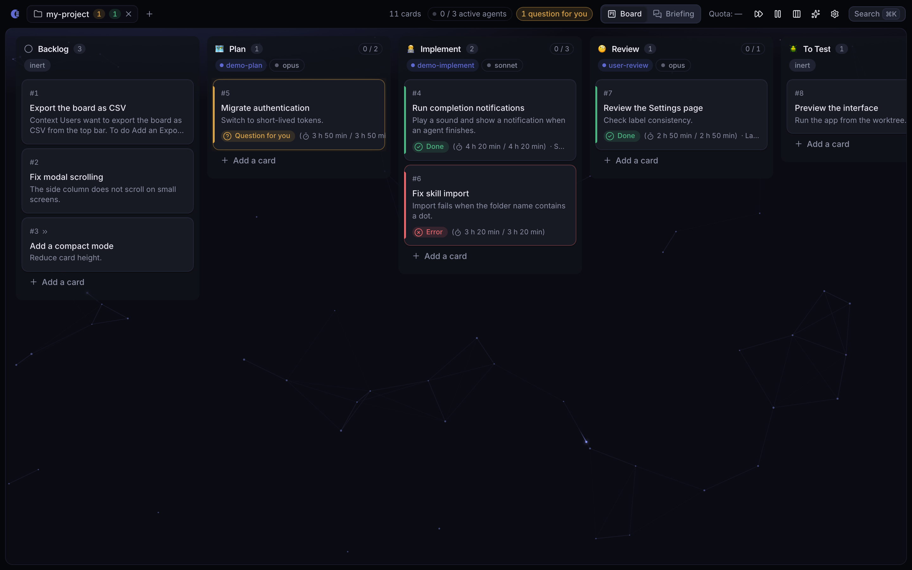

# Nightshift



[](LICENSE)
[](https://bun.sh)
[](https://docs.claude.com/en/docs/claude-code)

**Drop a card on a board, let Claude Code work through the night.** A kanban board that orchestrates Claude Code agents. One folder is one board: the whole board state lives in a single file, `nightshift.json`, at the folder root. Drop a card in a skill column and a `claude -p` agent picks it up in your project folder, reports progress, asks you questions when it is blocked, and hands the card to the next column. Leave it running and review the results in the morning.

- **Skill columns**: every card entering a column is processed by the skill you chose, in your project folder.
- **Batched questions**: a blocked agent returns all its questions at once; answering resumes the same session.
- **Feedback and resume**: send free-text feedback to the agent from any card.
- **Briefing**: a working session on your Backlog. The easy cards start at once, the others are decided with an agent, oldest first.
- **Fast forward and pause**: one button sends every ready Backlog card through the board in parallel, another pauses automatic runs.
- **Dependencies**: a card can wait in Backlog until other cards are done, then start on its own.
- **Project tabs**: keep several projects open in one browser tab and switch with a click or ⌥1–9.
- **One committable file**: the whole board is a single `nightshift.json`.
- **Template skills shipped**: grill, plan, implement, review and merge, copied into new projects.
- **Local only**: the server listens on `127.0.0.1` only.

[Quick start](#quick-start) · [Concepts](#concepts) · [Configuration](#configuration) · [Development](#development)

## Prerequisites

- [Bun](https://bun.sh) >= 1.4.2
- [Claude Code CLI](https://docs.claude.com/en/docs/claude-code) installed and logged in (check that `claude -p "hi"` answers)
- git
- macOS and Linux are supported; Windows is untested.

## Quick start

```sh
git clone https://github.com/MaximeGaudin/nightshift.git   # get Nightshift
cd nightshift && bun install                                 # install dependencies
claude -p "hi"                                               # check Claude Code is installed and logged in
bun start ~/code/my-project                                  # open a board for your project (opens http://localhost:4545)
```

1. On first launch Nightshift creates `nightshift.json` in your project and copies the 6 template skills into `<project>/.claude/skills/`. There is no skill install step.
2. Create a card in Backlog with a one-sentence request.
3. Drag it into Grill.

**What happens next.** The card flows Grill -> Plan -> Implement -> Review -> To Test -> Merge -> Done. When the agent needs a decision, its questions show on the card; answering in the card resumes the same session. The project must be a git repository, because the implement and merge skills use worktrees; `git init` is enough for a new folder.



## Concepts

- **Inert column**: cards just sit there.
- **Backlog column**: every board has a system Backlog column (id `col_backlog`, name `Backlog`), always first. It is inert, cannot be removed or reordered, and is recreated if missing; only its emoji can be edited. New cards from other programs land here (see below).
- **Done column**: every board has a system Done column (id `col_done`), always last. It is inert, cannot be removed or reordered, and is recreated if missing; agents moving a card into it raise no attention notification.
- **Skill column**: every card that enters it is processed by `claude -p` running the chosen skill, in the project folder. Each skill column has its own parallel agent limit (default 1, set in the columns editor); a per-project cap (default 3, set in Settings > This project and saved as `maxParallel` in the project's `nightshift.json`) bounds the agents running in that project; projects never block each other. A column whose skill runs the project's full test suite (usually Review) should keep its parallel limit at 1, so two suites never compete for the machine; Implement runs only the affected tests.
- When done, the agent returns structured output (`--json-schema`): updated title/description, `move` (`next`, `stay` or a column id) and a summary. Nightshift applies it to the card and, if moved into another skill column, the next skill starts automatically.
- **Session per card**: a column continues the card's Claude session (`claude --resume`) unless it has "Fresh session" ticked, which starts a new session there (the columns after it continue that new one). New skill columns, and the default board, have "Fresh session" ticked: the card description carries what each skill needs, and the context does not grow from column to column. Untick it on a column to keep the earlier context. Boards already on disk keep their columns as they are. If the card's session cannot be resumed (deleted, or created on another machine), the step starts a new one.
- **Questions**: when an agent is blocked on human decisions, it returns all its `questions` at once and the card waits in its column. Answering in the card resumes the same Claude session (`claude --resume`) with every Q/A pair. `AskUserQuestion` is disabled for agents.
- **Needs attention**: a run whose agent returns `move: "stay"` without questions in a skill column (every bundled skill does so when it stops unfinished: failed tests, timeout, missing branch), or returns while a background command it started is still running, is shown as "Needs attention" instead of done. Its output is applied but the card does not move, and it is not re-run on its own: use Retry or Resume. A run that returns before its background command ends is first resumed once with a prompt telling the agent to run the command again and wait for it. Agents are told to start any command longer than 2 minutes with `run_in_background: true` and an explicit `timeout` (up to 2 h), and to wait for it inside their turn: `claude -p` asks for the structured output as soon as a turn ends.
- **Project tabs**: the bar above the board lists the open projects (folder name, full path on hover, a counter of cards waiting for your answer). `+` opens the project picker; picking a project already open activates its tab. Click a tab, or press ⌘1–9 / Ctrl+1–9 / ⌥1–9, to switch without reloading the page. Closing a tab only hides it: the project and its agents keep running on the server. The open tabs are kept in the browser (`localStorage`), not in `nightshift.json`; a tab whose folder no longer opens stays and shows the error.
- **Dependencies**: a card in Backlog can depend on other cards of the board (`dependsOn`), chosen in the new card dialog or the card's detail. While one of them is not in Done, the card is held in Backlog (its tile shows "waiting #12, #15"). As soon as they are all in Done, Nightshift moves it to the first column after Backlog that it does not skip, and the column's agent starts as for a manual move; the history records "Dependencies done (#12, #15): Backlog → Grill" and the list is cleared, so a dependency leaving Done afterwards changes nothing. Dependencies can be edited only while the card is in Backlog, and a change that would create a cycle is refused. Removing the last unmet dependency, or deleting the card it waited for (a deleted dependency counts as met and is recorded as "Dependency #12 deleted"), releases the card at once. A card dragged out of Backlog by hand keeps its list but is never moved by it. Only the instance that runs the project's agents releases cards when a dependency reaches Done (never a `--no-agents` one); on opening a project it releases the cards whose dependencies finished meanwhile. Fast forward skips held cards.
- **Feedback**: from a card's detail, in any column (inert too), you can send free-text feedback to the agent. It resumes the card's last Claude session (`claude --resume`) with your text and the current card; the agent returns `move` (`stay`, `next` = the column after the card's current column, or a column id) and may ask questions as usual. A failed or cancelled run leaves the card in place and the feedback can be sent again.
- A card is (re)run when it enters a skill column; the rerun button forces a new run. Moving or deleting a card during a run stops its agent.
- **Progression**: a running card shows live progress (step N/M and a label). Agents emit a line `[nightshift-progress] N/M label` at each step (a numbered `## Progress` section in the card sets numbering and total); until a marker is seen, the agent's TodoWrite list is used instead. Last value wins, it resets at each (re)start of the agent and is never saved in `nightshift.json`.
- **Agent environment**: every agent prompt carries an `<environment>` block: the columns the card still goes through (current one marked, skipped ones listed), the project's worktree policy, and the titles of the other cards on the board (never their descriptions). The policy is set per project in Settings > This project and stored in `nightshift.json` as `worktreePolicy`: `required` (default, one git worktree per card), `auto` (the agent decides) or `forbidden` (agents work and commit in the shared checkout; keep the Implement column at 1 parallel agent). The template implement and merge skills obey it.
- Skills are read from `<project>/.claude/skills` (project, committable) and `~/.claude/skills` (user). Project skills shadow user skills. New skills are created in the project.

## Submitting tasks from other programs

A running Nightshift server accepts new cards over HTTP: `POST /api/backlog` creates a card in the Backlog column of a project.

```sh
curl -X POST http://localhost:4545/api/backlog \
  -H 'Content-Type: application/json' \
  -d '{"project": "/abs/path/to/project", "title": "Fix the login bug", "description": "Steps to reproduce...", "source": "ci-bot"}'
# 201 {"id":"card_...","number":12,"ref":"#12"}
```

Fields: `project` (required, absolute path, no `~`), `title` (required, not blank), `description` (optional), `skipColumnIds` (optional array of column ids), `dependsOn` (optional array of the cards it waits for: refs `"#12"`, numbers `12` or card ids; see Dependencies above), `source` (optional, up to 100 characters, recorded in the card history as "Created in Backlog by <source>"). Other fields, including `columnId`, are ignored: the card always goes to Backlog.

`POST /api/cards` accepts the same `dependsOn` (only for a card created in Backlog), and `PATCH /api/cards/:id` replaces it (`[]` clears it) while the card is in Backlog: elsewhere, or when the change would create a cycle, it answers 400.

Errors are `{ "error": "..." }`: 400 for an invalid body (including an unknown card or the card itself in `dependsOn`), 404 when the project has no `nightshift.json` (a board is never created this way). A project that has a board but is not open yet is opened automatically. The server must be running (default port 4545) and only listens on `127.0.0.1`; the request needs a local `Host`/`Origin` and `Content-Type: application/json`. It also works with `--no-agents`.

## Template skills

Nightshift ships six template skills in the repository's own `.claude/skills/` folder: `nightshift-grill`, `nightshift-plan`, `nightshift-implement`, `nightshift-review`, `nightshift-merge`, and `nightshift-submit` (lets an agent add a card to the project's backlog through `POST /api/backlog`). They are both the skills Nightshift runs on its own board and the templates for other projects: edit them there.

- When a new project gets its `nightshift.json` (the first time you open a folder), they are copied into `<project>/.claude/skills/`. A skill folder that already exists is never overwritten, and existing projects are left untouched.
- Project skills shadow the skills in `~/.claude/skills` (`NIGHTSHIFT_USER_SKILLS` overrides that user directory). Delete `<project>/.claude/skills/<name>` to fall back to your user skill of the same name.
- Customize a skill by editing its project copy, or in the Skills modal.
- If a copy fails, the board is still created and a toast names the skills that were not copied.

## Briefing

The board is the factory. The briefing is where you sit down with your Backlog: switch to it with the **Board / Briefing** control in the header, the `B` key, or the command palette. One briefing per project.

1. **Triage.** One agent call reads every Backlog card that is neither a draft nor held by its dependencies (at most 120, oldest first) and sorts them. *Easy*: an agent can build it without asking you anything. *To decide*: a product decision is missing. Related cards to decide are grouped into one topic, so you decide once.
2. **Ready to launch.** The easy cards are shown in full: what the agent will build, why nothing is to decide, and the card's own description. Untick what should wait, send a card to a conversation with **Discuss first**, then launch: the cards go to the first column after the Backlog that they do not skip.
3. **To decide, oldest first.** Each topic is a conversation. The agent reads the code and writes a short briefing (what this is about, what exists today, how the cards relate), then lists the decisions to make, each with options and the one it recommends. Pick options, write your own answer, or ask anything. **Take the recommendations** fills every open answer; **Let the agent decide the rest** settles what is left.
4. **Launch.** As soon as no decision is open, the agent writes `## Decisions` and `## Acceptance` into each card and the cards leave the Backlog. When you have answered every question, the view moves to the next topic without waiting: a topic comes back to you only if your answer opens a new decision.

Two topics are prepared ahead of you, so the next conversation is ready when you finish one. **Launch as is** sends the cards of a topic as they are; **Leave in Backlog** skips it. Cards created during the briefing can be triaged from the bottom of the left rail. A card moved or deleted on the board leaves the briefing.

The briefing agents are read-only (`Edit`, `Write` and `NotebookEdit` are denied) and run outside the card queue: a conversation never waits for a free agent slot, and it also runs while the project is paused. A launched card then runs like any card moved by hand. The briefing is saved in `~/.nightshift/briefings/` (never in `nightshift.json`): it survives a restart, and a turn that was in flight can be retried. Ending the briefing forgets the conversations; what was written to the cards stays. The routes are under `/api/briefing` and the state is pushed as a `briefing` WebSocket event.

## Fast forward and pause

Two buttons in the board header, per project.

**Fast forward** (double arrow, off by default). When on, Nightshift moves every Backlog card that is not held by its dependencies out of the Backlog at once, in Backlog order, to the first column after it that the card does not skip. Each of these cards also skips the inert columns (except Done), so it goes all the way to Done without a human step. The orchestrator then runs as many of them as the project and column limits allow; the others wait as "queued". Fast forward stays on until you turn it off: a card created in, moved back to or released into the Backlog later is taken at once, and a card released by its dependencies while fast forward is on gets the same inert skips. Turning fast forward on also requeues, like Retry, every card whose last run in its own skill column was cancelled (history "Fast forward: retry of cancelled run"); failed runs and pending questions are left alone, and while paused these cards wait for play. A card cancelled while fast forward is already on stays cancelled. A failed, cancelled or kept card only stops itself; the others go on.

**Pause** (play by default). While paused, no automatic agent run starts in the project. A running agent finishes its work, its card moves where the result says, and then waits there with a "Paused" badge until you press play again. On play, waiting cards start in `enteredColumnAt` order within the usual limits. Fast forward does not move Backlog cards while paused.

| Trigger | While paused |
|---|---|
| Card moved by an agent into a skill column | waits |
| Card released by its dependencies | moves, its run waits |
| Card dragged by hand into a skill column | moves, its run waits |
| Retry button | starts |
| Feedback sent from the card | starts |
| Answer to an agent question | starts |

An explicit action that starts during a pause still respects the parallel limits. Quick runs from the command palette are not paused.

Both states are kept in memory (never in `nightshift.json`): after a restart, the project plays and fast forward is off. The routes are `POST /api/flow/fast-forward/on`, `/api/flow/fast-forward/off`, `/api/flow/pause` and `/api/flow/play` (`{project}`), each returning `{ flow: { fastForward, paused } }`, and rejected with 409 on an instance without agents or a project whose agents another process runs.

## Language

The interface is available in English and French. Choose it in Settings -> Language: Auto (follows the browser language), English or French. The choice is stored as `language` (`auto`, `en` or `fr`) in `~/.nightshift/settings.json` and applies immediately. Server messages, agent prompts and skills stay in English.

## Configuration

```sh
bun start [project-dir] [--port 4545] [--no-open] [--no-agents]   # defaults to the current directory
```

Options: `--port <n>` / `-p <n>` (0..65535, also read from the `PORT` environment variable, default 4545), `--no-open` (do not open the browser), `--no-agents` (never start agents), `--help`. Environment: `NIGHTSHIFT_HOME` (data directory, default `~/.nightshift`), `NIGHTSHIFT_USER_SKILLS` (user skills directory, default `~/.claude/skills`), `NIGHTSHIFT_NO_OPEN` (set to any value to skip opening the browser).

The server listens on `127.0.0.1` only, and rejects requests whose `Host` or `Origin` is not local or whose body is not `application/json`.

## teamclaude

[teamclaude](https://github.com/KarpelesLab/teamclaude) is a local proxy that pools several Claude accounts and moves to the next one when a quota runs out. Nightshift can run its agents through it. Install it (`npm install -g @karpeleslab/teamclaude`), add your accounts and start `teamclaude server` yourself: Nightshift never installs, starts or configures it.

Then turn on **Run agents through teamclaude** in Settings (off by default) and check the proxy URL (default `http://localhost:3456`). Both are global settings (`teamclaudeEnabled`, `teamclaudeUrl` in `~/.nightshift/settings.json`). With the option on:

- Before each `claude -p` (card runs, feedback and quick runs), Nightshift checks `GET <url>/teamclaude/quota` (2 s at most), then adds the variables printed by `teamclaude env` to the agent's environment. The command and its arguments do not change; the card log says "via teamclaude".
- When teamclaude is not on the `PATH`, `teamclaude env` fails or the proxy does not answer, the run waits and no `claude` starts. The card shows that it waits, and a dialog opens in every open tab with the reason and the waiting runs: **Retry** checks again, **Run without teamclaude** starts these runs directly (the next run checks again), **Cancel the runs** fails them with "teamclaude proxy unreachable at <url>" (the card stays in its column and can be rerun). A choice closes the dialog everywhere. A waiting run counts toward the parallel limits; moving or deleting its card removes it; turning the option off starts the waiting runs directly.
- The header shows the pooled quota of all the accounts, read from `/teamclaude/quota` every 60 s, with the account count in its tooltip. When the proxy stops answering, the gauge keeps the last values, dimmed. The agents' own `rate_limit_info` is still recorded and comes back when the option is turned off.

## Files

- `<project>/nightshift.json`: columns and cards. Commit it in your projects. This repository ignores it (`.gitignore`): it is the dogfooding board of Nightshift itself. External edits (e.g. `git pull`) are picked up live.
- `~/.nightshift/settings.json`: global settings (permission mode, model, extra `claude` args, teamclaude, recent projects).
- `~/.nightshift/logs/`: last agent log per card (removed with the card).
- `~/.nightshift/screenshots/`: card screenshots.
- `~/.nightshift/briefings/`: the briefing of each project (triage result and conversations).
- `~/.nightshift/locks/`: one lock per open project folder.

## Permissions

Agents run unattended with the configured `--permission-mode` (default `auto`: Claude Code's classifier approves or denies each action; anything it would escalate to a human is denied, since nobody is watching). Use the extra arguments setting for `--allowedTools`, `--max-budget-usd`, etc. `bypassPermissions` lets agents run any command in the project folder.

## Development

```sh
bun run dev    # same as start (development mode: HMR and browser console echo unless NODE_ENV=production)
bun test
```

Scripts: `bun run lint` (Biome), `bun run format`, `bun run typecheck`, `bun test` (sequential, for debugging), `bun run test:parallel`, `bun run test:coverage`, and `bun run check` (lint + typecheck + parallel tests, run it before committing). Code is formatted and linted with [Biome](https://biomejs.dev).

`bun run test:parallel` (`scripts/test-parallel.ts`) splits `test/**/*.test.{ts,tsx}` into groups, one `bun test` process each, balanced with the durations of the previous run (`.test-timings.json`, git-ignored), then prints one summary and exits non-zero if any group fails or crashes. `TEST_JOBS=N` or `--jobs N` sets the group count (default: cores, at most 8); extra arguments filter files by path substring. Bun 1.2.15 (this machine) has no native parallelism between test files, so the script is the parallelism; `bun test --reporter=junit` is used to learn per-file durations. If a newer Bun gains a native option, prefer it and drop the script.

## Layout

- `bin/nightshift.ts`: CLI entry point.
- `src/server/`: `store.ts` (board file), `orchestrator.ts` (queue, `claude` processes, questions), `briefing.ts` (backlog triage and decision conversations), `skills.ts`, `settings.ts`, `server.ts` (HTTP + WebSocket API, serves the UI).
- `src/web/`: React UI bundled by Bun.
- `src/web/i18n/`: in-house translation layer, `en/` and `fr/` message files per namespace.
- `.claude/skills/`: the skills Nightshift runs on its own board, also the templates copied into new projects.
- `docs/assets/`: README banner and screenshot.
- `docs/logo/`: logo source.
- `test/`: tests, with `fake-claude.ts` standing in for the CLI.
- `.github/`: CI workflow, issue and pull request templates.

## Questions and bugs

Use [GitHub Issues](../../issues). To contribute, see [CONTRIBUTING.md](CONTRIBUTING.md); the project follows its [Code of Conduct](CODE_OF_CONDUCT.md) and [Security Policy](SECURITY.md). Released under the [MIT License](LICENSE).
